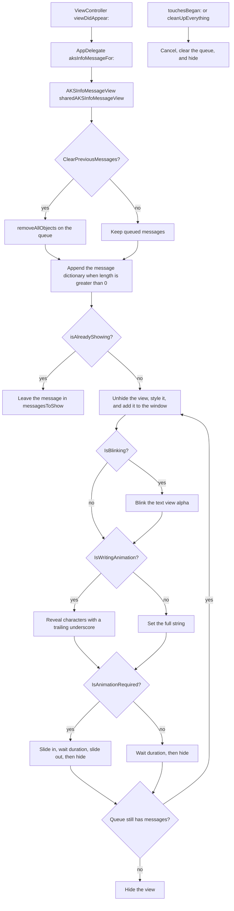
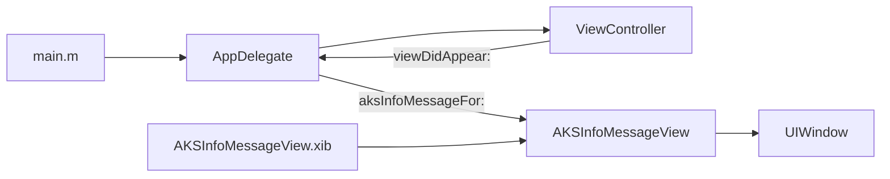

# WritingAnimationMessageView

[](https://github.com/aryansbtloe/WritingAnimationMessageView)
[](https://github.com/aryansbtloe/WritingAnimationMessageView)
[](LICENSE)

WritingAnimationMessageView is an iOS sample app that shows an alert-style text message with a typing animation. `AKSInfoMessageView`, a singleton `UIView` loaded from a nib, queues messages and draws them in a `UITextView` over a rounded background image view. Callers choose how long the message stays up, the point size, the RGB color, whether the background is hidden, whether the text blinks, whether characters appear one by one, and whether the text view slides on and off the window.

The Xcode project was created on 30 April 2013. It is a single application target with Automatic Reference Counting, a deployment target of iOS 6.1, and no third-party libraries.

## Features

- **Typing animation.** When `IsWritingAnimation` is `YES`, `writingAnimation` reveals the string one character at a time and draws a trailing ` _` cursor until the string is complete. The delay between characters is random. Messages longer than 32 characters use 0.09 s, 0.05 s, or 0.01 s. Shorter messages use 0.2 s, 0.1 s, or 0.05 s.
- **Immediate text.** When writing animation is off, the text view receives the full string at once.
- **Slide on and off.** When `IsAnimationRequired` is `YES`, a `CABasicAnimation` on `position` moves the text view in from 320 points to the left over 0.3 seconds. After `duration` seconds it moves 320 points to the right over 0.5 seconds, then the view hides 0.4 seconds later. The animation does not change the view's frame.
- **Timed dismiss.** `duration` is an `NSTimer` interval in seconds. The timer starts when the message is shown, including while characters are still being typed. When the flag is off, the view hides after that interval with no slide.
- **Blink.** When `IsBlinking` is `YES`, the text view alpha animates from 0 to 1 over 0.2 seconds, autoreverses, and repeats 640 times.
- **Color and typeface.** The text color is `+[UIColor colorWithRed:green:blue:alpha:]` using the integer `r`, `g`, and `b` arguments as the components and an alpha of 1. That initializer treats components as values from 0 to 1 and clamps anything above 1, so the sample value `255` is full intensity. The font is the system face `Marker Felt` at the requested point size.
- **Text only or backed by the image view.** `ShowTextOnly` hides `imageView` and the vertical scroll indicator. Otherwise the image view stays visible and the vertical scroll indicator is turned on.
- **Frame.** A `Frame` whose width is greater than 0 is applied to both `imageView` and `messageView`. `CGRectZero` uses a rectangle inset from the screen bounds by one sixth of the width and one sixth of the height, which is the center two thirds of the screen.
- **Queue.** Each non-empty message is stored as a dictionary (`Message`, `Duration`, `FontSize`, `ShowTextOnly`, `IsAnimationRequired`, `RGB_r`, `RGB_g`, `RGB_b`, `Blink`, `IsWritingAnimation`, `Frame`). A new message waits while `isAlreadyShowing` is true. `ClearPreviousMessages` empties the queue before the new message is added. An empty string is not enqueued.
- **Cancel.** `touchesBegan:withEvent:` and `-cleanUpEverything` set `isCancelled`, clear the text, empty the queue, and hide the view. Later timer callbacks return immediately once `isCancelled` is set. In `AKSInfoMessageView.xib` the root view's user interaction starts disabled.
- **Rounded overlay.** Both the text view and the image view get a corner radius of 10. The view is added as a subview of the application window.
- **Exception logging macros.** `TCSTART` / `TCEND` wrap the view's methods. See [Customisation](#customisation).

## How a message is shown





## Requirements

- Xcode that can open this project. The project object is `compatibilityVersion` Xcode 3.2, and `LastUpgradeCheck` is `0460` (Xcode 4.6). The shared scheme is `WritingAnimationMessageView`.
- iOS SDK for the `iphoneos` SDK root. `IPHONEOS_DEPLOYMENT_TARGET` is **6.1**. The prefix header warns if the SDK is older than iOS 4.0.
- The target builds with ARC (`CLANG_ENABLE_OBJC_ARC = YES`) and GNU C99.
- Device family **1,2** (iPhone and iPad). `Info.plist` requires `armv7` and iPhone OS.
- Linked system frameworks: UIKit, Foundation, CoreGraphics, and QuartzCore.
- Supported orientations in `WritingAnimationMessageView-Info.plist`: portrait, landscape left, and landscape right on iPhone, plus portrait upside down on iPad.
- Bundle identifier `com.kiplmobile24.WritingAnimationMessageView`, version `1.0` (`CFBundleShortVersionString` and `CFBundleVersion`).
- No third-party dependencies. The repository has no Podfile, podspec, Cartfile, or `Package.swift`.

## Installation

Clone the repository and open the Xcode project:

```sh
git clone https://github.com/aryansbtloe/WritingAnimationMessageView.git
cd WritingAnimationMessageView
open WritingAnimationMessageView.xcodeproj
```

In Xcode, select the **WritingAnimationMessageView** scheme, pick an iOS Simulator or a device, and run. The sample message appears from `ViewController`'s `viewDidAppear:`.

CocoaPods and Swift Package Manager are not set up in this repository. The message view is source and a nib inside the application target, not a separate library target.

## Usage

The sample app calls the method declared on `AppDelegate`. This is the call in `ViewController.m`:

```objc
[((AppDelegate*)[[UIApplication sharedApplication]delegate]) aksInfoMessageFor:5
    withMessage:@"This is a demo text message....with lots of options to configure"
    withFontSize:30
    ShowTextOnly:YES
    IsAnimationRequired:NO
    ClearPreviousMessages:YES
    ColorWithR:255 G:0 B:0
    IsBlinking:NO
    IsWritingAnimation:YES
    Frame:CGRectZero];
```

That shows the demo sentence for 5 seconds, in `Marker Felt` at 30 points, text only, no slide, replacing any queued messages, with red at full intensity, no blink, and the typing animation. `CGRectZero` selects the default centered frame.

`AppDelegate` forwards to the singleton. The view method is the same argument list, with the animation flag spelled `isAnimationRequired`:

```objc
[[AKSInfoMessageView sharedAKSInfoMessageView]
    aksInfoMessageFor:duration
    withMessage:message
    withFontSize:size
    ShowTextOnly:showTextOnly
    isAnimationRequired:isAnimationRequired
    ClearPreviousMessages:clear
    ColorWithR:r G:g B:b
    IsBlinking:blink
    IsWritingAnimation:isWritingAnimation
    Frame:Frame];
```

Declaration on `AppDelegate`:

```objc
-(void)aksInfoMessageFor:(float)duration
             withMessage:(NSString*) message
            withFontSize:(int)size
            ShowTextOnly:(BOOL)showTextOnly
     IsAnimationRequired:(BOOL)isAnimationRequired
  ClearPreviousMessages:(BOOL)clear
              ColorWithR:(int) r G:(int)g B:(int) b
              IsBlinking:(BOOL)blink
     IsWritingAnimation:(BOOL)isWritingAnimation
                   Frame:(CGRect) Frame;
```

| Argument | Role |
| --- | --- |
| `duration` | Seconds before the message is dismissed. The timer starts as soon as the message is shown. |
| `message` | Text to show. A `nil` or zero-length string is not added to the queue. |
| `size` | Point size of `Marker Felt`. |
| `ShowTextOnly` | `YES` hides the background image view and the vertical scroll indicator. |
| `IsAnimationRequired` / `isAnimationRequired` | `YES` slides the text view in and out. `NO` only waits, then hides. |
| `ClearPreviousMessages` | `YES` removes every queued message before this one is added. |
| `r`, `g`, `b` | Integer components passed straight to `colorWithRed:green:blue:alpha:`. Values above 1 are clamped to 1. |
| `IsBlinking` | `YES` starts the alpha blink animation. |
| `IsWritingAnimation` | `YES` types the string. `NO` sets the whole string at once. |
| `Frame` | Used when `size.width > 0`. Otherwise the view uses the centered two-thirds of the screen. |

The same flags cover the other built-in behaviours. A slide, a blink, a visible background, and a fixed frame use the method above with `IsAnimationRequired:YES`, `IsBlinking:YES`, `ShowTextOnly:NO`, and a non-zero `CGRect`.

Dismiss the current message and drop the queue from the view:

```objc
[[AKSInfoMessageView sharedAKSInfoMessageView] cleanUpEverything];
```

`AppDelegate.m` also implements `-cleanupMessages`, which calls `cleanUpEverything`. That method is not declared in `AppDelegate.h`.

The singleton is created once, with `dispatch_once`, by loading `AKSInfoMessageView.xib` and taking the first object. `+alloc` asserts if a second instance is allocated. The nib's root object is `AKSInfoMessageView`. Its File's Owner custom class is recorded as `ASAlertView`, and this repository has no `ASAlertView` class. The outlets `messageView` and `imageView` are connected on the root view, and the load passes the app delegate as the nib owner.

## Project structure

```
.
├── LICENSE
├── README.md
├── ViewController.h              Root of the repo; referenced from the app group
├── ViewController.m              Shows the sample message in viewDidAppear:
├── ViewController.xib            Empty white root view, Retina 4 full screen
├── WritingAnimationMessageView/
│   ├── AppDelegate.h             Public message method
│   ├── AppDelegate.m             Window setup and forwarder to the singleton
│   ├── Default.png               Launch images
│   ├── Default@2x.png
│   ├── Default-568h@2x.png
│   ├── MessageView/
│   │   ├── AKSInfoMessageView.h  View interface, plus TCSTART / TCEND macros
│   │   ├── AKSInfoMessageView.m  Queue, typing, blink, slide, and dismiss
│   │   └── AKSInfoMessageView.xib
│   ├── WritingAnimationMessageView-Info.plist
│   ├── WritingAnimationMessageView-Prefix.pch
│   ├── en.lproj/InfoPlist.strings
│   └── main.m
└── WritingAnimationMessageView.xcodeproj
```

`ViewController.h`, `ViewController.m`, and `ViewController.xib` live at the repository root. The Xcode group stores them with a `../` path. Launch images use the pre-asset-catalog names `Default.png`, `Default@2x.png`, and `Default-568h@2x.png`.

The message nib is a 320 by 480 view. It contains a white `UIImageView` at alpha 0.7 and a non-editable, non-scrolling `UITextView` (Helvetica 14 and center alignment in the nib). At show time the implementation replaces the frames, sets `Marker Felt`, sets the color, and turns the vertical scroll indicator on or off.

There is one target, `WritingAnimationMessageView`, and the shared scheme has no test target.

## Customisation

These are the switches and hardcoded values that exist in the source.

**`UseTryCatch` and `UsePTMName`** are defined in `AKSInfoMessageView.h` when nothing has defined them yet:

| Macro | Default | Effect |
| --- | --- | --- |
| `UseTryCatch` | `1` | `TCSTART` / `TCEND` wrap methods in `@try` / `@catch`. A caught `NSException` is logged with the file name, line, method, and `reason`, and is not rethrown. Set to `0` and the macros expand to nothing. |
| `UsePTMName` | `0` | When `UseTryCatch` is also enabled, `TCSTART` logs `__PRETTY_FUNCTION__`. The header comment says to leave this off except while tracing unexpected calls. |

The prefix header is precompiled for every source file in the target and does not define either macro. A `#define` placed in `WritingAnimationMessageView-Prefix.pch` is visible before `AKSInfoMessageView.h` is imported. Defining them after that import has no effect.

**Values fixed in `AKSInfoMessageView.m`**, changed by editing that file:

- Typeface name: `@"Marker Felt"`. Only the point size is a parameter.
- Slide distance: `320` points. Show duration `0.3` s, hide duration `0.5` s, then `0.4` s before the view hides.
- Typing delays: `0.09` / `0.05` / `0.01` when `textToDisplay.length > 32`, otherwise `0.2` / `0.1` / `0.05`. The branch is `arc4random() % 6`: 5 uses the slowest delay, 3 or 4 the middle delay, and 0, 1, or 2 the fastest.
- Blink: duration `0.2`, autoreverses, repeat count `640`.
- Corner radius: `10` on `messageView` and `imageView`.
- Default frame: `CGRectInset` of the main screen bounds by `width/6` and `height/6`.

**Build settings** in the project: deployment target iOS 6.1, ARC on, `DEBUG=1` in the Debug configuration, and `-DNS_BLOCK_ASSERTIONS=1` in Release. The Xcode project organization name is Konstant Info Private Limited. Source file headers still say `Copyright (c) 2013 Konstant Info Private Limited`.

## Contributing

Issues and pull requests are welcome on [GitHub](https://github.com/aryansbtloe/WritingAnimationMessageView).

1. Fork the repository and branch from `master`.
2. Keep changes limited to the behaviour you are fixing or extending. The message view, the app delegate forwarder, and the sample call in `ViewController.m` are the pieces that define the app.
3. Open `WritingAnimationMessageView.xcodeproj`, build the `WritingAnimationMessageView` scheme, and run it. The project has no test target, so the check is that the sample message still appears and that the flags you touched still match `aksInfoMessageFor:withMessage:withFontSize:ShowTextOnly:isAnimationRequired:ClearPreviousMessages:ColorWithR:G:B:IsBlinking:IsWritingAnimation:Frame:`.
4. Open a pull request against `master` and describe the behaviour change.

## License

This repository is released under the [MIT License](LICENSE). Copyright (c) 2026 Alok Singh.

## Author

**Alok Singh**

- GitHub: [https://github.com/aryansbtloe](https://github.com/aryansbtloe)
- Website: [https://bestlatestapps.com](https://bestlatestapps.com)
